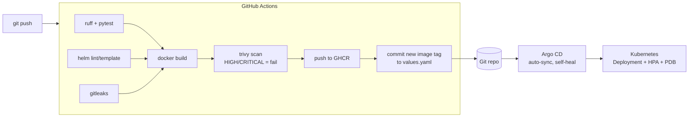

# k8s-gitops-starter

[](https://github.com/TienMinh1727/k8s-gitops-starter/actions/workflows/ci.yaml)

A small but production-style reference for shipping a service to Kubernetes with **GitOps**:
every push to `main` is linted, tested, secret-scanned, built, vulnerability-scanned and
published — then Argo CD rolls it out by syncing the Helm chart from Git.



## What's inside

| Path | Purpose |
|---|---|
| `app/` | FastAPI service with `/healthz`, `/readyz`, `/version` and a small CRUD API |
| `tests/` | pytest suite (happy paths, validation, 404s) |
| `Dockerfile` | Multi-stage build, slim base, runs as non-root UID 10001 |
| `charts/demo-api/` | Helm chart: Deployment, Service, HPA, PodDisruptionBudget, optional Ingress + cert-manager TLS |
| `argocd/application.yaml` | Argo CD `Application` with automated sync, prune and self-heal |
| `.github/workflows/ci.yaml` | CI/CD pipeline shown above |
| `scripts/kind-deploy.sh` | One-command local deploy to a [kind](https://kind.sigs.k8s.io) cluster |

## Security defaults

- Container runs as **non-root** with a **read-only root filesystem**, all Linux capabilities dropped, no privilege escalation and the `RuntimeDefault` seccomp profile.
- Service account token is not mounted.
- CI fails on leaked secrets (Gitleaks) and on fixable HIGH/CRITICAL CVEs (Trivy).
- Rolling updates with `maxUnavailable: 0` plus a PodDisruptionBudget keep the service available during deploys and node drains.

## Run it

```bash
# local development
make install
make test
make run            # http://localhost:8080/docs

# container
make docker-build docker-run

# local Kubernetes (needs docker, kind, helm)
make kind-deploy
kubectl -n demo port-forward svc/demo-demo-api 8080:80
curl localhost:8080/healthz
```

## GitOps with Argo CD

```bash
kubectl apply -f argocd/application.yaml
```

Argo CD watches `charts/demo-api` on `main`. When CI pushes a new image it commits the
new tag to `values.yaml`; Argo CD detects the change and rolls it out. Rolling back is a
`git revert`.

## Notes

- The API stores data in memory on purpose. The repo is about the delivery pipeline, not the app.
- To publish images, make the GHCR package public or give your cluster an image pull secret.
